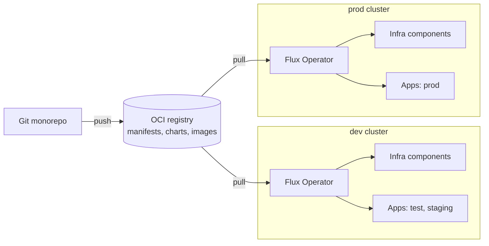
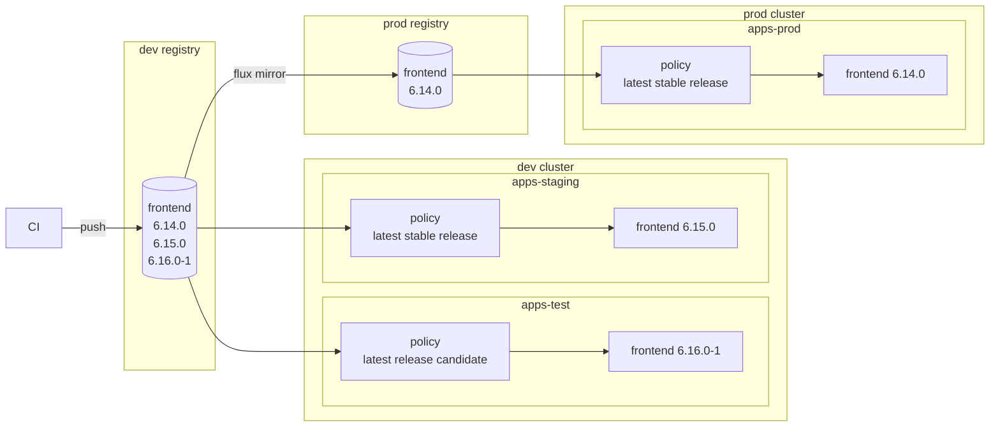

# flux-mono-example

Example of a Gitless GitOps monorepo: the Kubernetes desired state lives in
Git, but the cluster doesn't connect to the Git server.
Manifests, Helm charts and app images are pushed to an OCI registry,
and [Flux Operator](https://fluxoperator.dev) generates the delivery
pipeline from the directory layout.

What that means in practice:

- **Infra is driven by folders.** To install cert-manager on a cluster you
  create `kubernetes/infra/components/cert-manager/` with a HelmRelease and an
  overlay per cluster; Flux Operator notices the folder and deploys it. Delete
  the folder and it's uninstalled. You never write a Flux Kustomization for it.
- **App releases don't need a commit.** For each app, Flux Operator watches
  the container registry and picks the newest image tag that matches the
  environment's rule (for example "latest stable version" in staging and prod,
  "release candidates" in test). Push a new image and it rolls out.
- **Cluster environments and app environments are separate.** A cluster is
  `dev` or `prod`, which decides how infra is configured. On top of that, apps
  run in *app environments*: `test`, `staging` and `prod`. Each app environment
  is a namespace that contains a copy of every app. The dev cluster hosts
  `test` and `staging`; the prod cluster hosts `prod`. Adding another app
  environment to a cluster is one small file.

## How it works



Git holds the source of truth, the registry is what the cluster consumes, and
Flux Operator turns directories into Kustomizations. Image tags flow directly
from the registry to the app deployments — no commit per release.

### App delivery

Each cluster has its own image registry (`app_registry` in `flux-vars`), and
each app env has its own image policy — a semver range in
`clusters/<cluster>/apps-<app_env>-reconcilers.yaml`. CI pushes to the dev
registry; promotion to prod is copying the image to the prod registry:



Pushing `6.16.0` to the dev registry rolls it out to `test` and `staging` on
the next scan; pushing `6.17.0-1` only reaches `test`. Nothing reaches `prod`
until someone (or a pipeline) runs `flux mirror` into the prod registry; the
range can additionally be pinned per app env (e.g. `6.14.x` on `prod`).

## Layout

```text
kubernetes/
├── clusters/<cluster>/       # FluxInstance, flux-vars, reconciler Kustomizations
├── infra/
│   ├── reconcilers/          # ArtifactGenerator + RSIP + ResourceSet per layer
│   ├── core/                 # namespaces, network policies
│   └── components/<name>/    # {controllers,configs}/{base,envs/<env>}
└── apps/
    ├── reconcilers/          # generic; applied once per app env
    └── <app>/                # plain manifests, {base,envs/<app_env>}
```

## Try it locally

Requires Docker and [Homebrew](https://brew.sh). Everything else (kind, kubectl,
flux + plugins) is installed by `make tools`.

```sh
make tools   # brew bundle + flux plugins
make up      # kind cluster + local registry, mirror charts/images, push manifests, install Flux
make ls      # see what got deployed
make flux-web  # Flux Web UI at http://localhost:9080
```

Day to day:

```sh
# edit manifests under kubernetes/
make vet     # kustomize build + schema validation
make sync    # push the artifact and reconcile
# inspect the result in the Flux Web UI at http://localhost:9080
```

## Working with AI agents

This repo is designed to be operated by coding agents, with humans steering.
The conventions are strict and mechanical on purpose: a component or app is a
directory with a fixed shape, environments are overlays with fixed names, and
every rule an agent needs is written down in [AGENTS.md](AGENTS.md) and
`docs/`. `make vet` validates the whole tree (kustomize build + Flux and
Kubernetes schemas), so an agent can check its own work before anything
reaches a cluster.

In practice you say things like "add envoy-gateway to the infra components",
"onboard a new app called `payments`" or "promote the apps to production",
and the agent creates the directories, mirror entries and reconciler files,
runs `make vet` and `make sync`, and reports what got deployed. The
`.agents/skills/gitops-knowledge` skill gives it the Flux and Flux Operator
API references, so it can generate schema-valid resources without guessing.

To update the skill run `flux operator skills update`.

## Docs

| Guide | What it covers |
|-------|----------------|
| [Repository structure](docs/repo-structure.md) | Directory layout, cluster envs vs app envs, and how the pieces fit together |
| [Reconciliation pipeline](docs/reconciliation.md) | How Flux Operator turns directories into deployments (ArtifactGenerator → ResourceSetInputProvider → ResourceSet), and how apps get per-app-env gitless image automation |
| [Onboarding an infra component](docs/onboarding-infra.md) | Step-by-step guide to add a new infrastructure component (Helm chart + configs) |
| [Onboarding an app](docs/onboarding-apps.md) | Step-by-step guide to add an application (base + test/staging/prod overlays), host a new app env and promote versions |
| [Registry and artifacts](docs/registry-and-artifacts.md) | How charts and app images are mirrored and manifests are pushed to the local registry |
| [Local development](docs/local-development.md) | Tooling, `make` targets, validation with `make vet`, and the day-to-day workflow |
